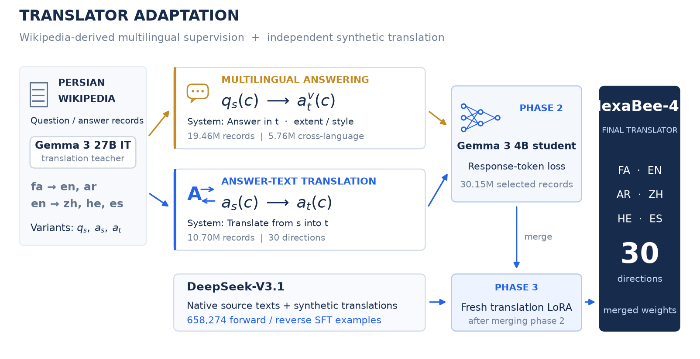

# HexaBee-4B

**Six-language translation with multilingual answering and bidirectional supervision.**

A modular research codebase accompanying the HexaBee-4B manuscript. It covers multilingual Wikipedia QA construction, system-prompt pools, synthetic translation generation, LoRA training configuration, automatic metrics, model judging, paired bootstrap intervals, and paper artifacts.

**Languages:** Persian (`fa`), English (`en`), Arabic (`ar`), Chinese (`zh`), Hebrew (`he`), Spanish (`es`). All 30 non-identity translation directions are evaluated.

[Model & inference](https://huggingface.co/Iman998/HexaBee-4B) · [Paper PDF](paper/HexaBee-4B_WAT2026.pdf) · [Portable paper source](paper/HexaBee-4B_WAT2026_source.zip) · [Quick start](#quick-start) · [Evaluation](docs/evaluation.md) · [راهنمای فارسی](docs/README.fa.md)


The manuscript is a **submission draft**. The benchmark below reports archived research results with synthetic references and differing recorded inference prompts; it is not an official shared-task ranking.

## Explore the release

| Stage | Data and evidence | Checkpoint |
|:--|:--|:--|
| 01 · Wikipedia | [Wikipedia Foundations](https://huggingface.co/datasets/Iman998/HexaBee-Wikipedia-PT) | [PT LoRA](https://huggingface.co/Iman998/HexaBee-4B-PT-LoRA) |
| 02 · Multilingual answering | [Answering & translation SFT](https://huggingface.co/datasets/Iman998/HexaBee-Multilingual-SFT) | [SFT LoRA](https://huggingface.co/Iman998/HexaBee-4B-Multilingual-SFT-LoRA) · [Merged base](https://huggingface.co/Iman998/HexaBee-4B-Multilingual-Base) |
| 03 · Bidirectional translation | [Aligned pairs & final SFT](https://huggingface.co/datasets/Iman998/HexaBee-Bidirectional-Translation) | [Translation LoRA](https://huggingface.co/Iman998/HexaBee-4B-Translation-LoRA) · [Final model](https://huggingface.co/Iman998/HexaBee-4B) |
| Audit & reuse | [Prompt Hive](https://huggingface.co/datasets/Iman998/HexaBee-System-Prompts) · [Translation Archive](https://huggingface.co/datasets/Iman998/HexaBee-Model-Outputs) · [Evaluation Atlas](https://huggingface.co/datasets/Iman998/HexaBee-Evaluation) | [Paper PDF](paper/HexaBee-4B_WAT2026.pdf) |

Each Hub card identifies the released unit, provenance, limitations, and exact adapter base. The [publication guide](docs/huggingface.md) gives streaming loaders and resumable upload commands. The historical `pct4b` Python namespace and numeric artifact keys remain supported for compatibility.

Guides: [Data construction](docs/data.md) · [Generation](docs/generation.md) · [Training](docs/training.md) · [Evaluation](docs/evaluation.md) · [Reproduction boundaries](docs/reproducibility.md).

## The method

For an aligned content item, let $q_s$ denote its question in language $s$ and $a_t^v$ its answer in language $t$ and response style $v$. Multilingual answering trains

$$p_\theta(a_t^v\mid S_{p,t,v},q_s),$$

where the system instruction $S$ specifies the answer language and, where applicable, style or extent. Direct translation instead trains $p_\theta(a_t\mid S^{\mathrm{MT}}_{p,s,t},a_s)$. The language $p$ used to express the system instruction adds diversity. The answering task requires answering the question; it does not ask the model to translate that question.

The full adaptation sequence is **Wikipedia continued pretraining → multilingual answering + answer-text translation → merge → fresh translation LoRA → final merge**. Translation is the primary evaluation task. The available experiments evaluate this complete sequence; they do not isolate the causal contribution of multilingual answering.



## Quick start

Run commands from the repository root. Python 3.10 or later is required; the release was tested with Python 3.11. No GPU or API key is needed for this example.

```bash
python3 -m venv .venv
source .venv/bin/activate
python -m pip install -e '.[metrics,plots,hub,dev]'
hexabee --help

hexabee normalize-wiki --input examples/wiki.jsonl --output runs/demo/wiki.jsonl
hexabee prompts seeds --output runs/demo/prompts.jsonl
hexabee qa-build --input runs/demo/wiki.jsonl --recipe configs/qa_demo.json \
  --pools runs/demo/prompts.jsonl --output runs/demo/qa.jsonl
hexabee export-sft --input runs/demo/qa.jsonl --output runs/demo/qa_train.jsonl
hexabee mt-build --input examples/pairs.jsonl --output runs/demo/mt.jsonl

hexabee metrics --input examples/demo_a.jsonl examples/demo_b.jsonl \
  --output runs/demo/metrics.json
hexabee bootstrap --input examples/demo_a.jsonl examples/demo_b.jsonl \
  --system demo_b --baselines demo_a --output runs/demo/bootstrap.json
hexabee report --input runs/demo/metrics.json --output runs/demo/report \
  --focus demo_b --plots
pytest -q
```

`examples/` contains tiny, hand-authored fixtures and deliberately artificial model/judge scores. **Demo scores are not paper results.** The demo creates three QA/translation examples and 60 forward/reverse translation examples. The 36 seed prompts are illustrative; import the original paraphrase pools to replay the historical construction.

## Reproduce the released paper artifacts

```bash
python scripts/reproduce_paper.py --plots
python scripts/build_paper_figures.py
```

The first command verifies saved metric statistics and data counts, recomputes paired score intervals, and writes `runs/paper/`. The second produces eight figure families in `figures/`, each as PDF, SVG, and PNG. Tables combine systems for each direction, group incoming directions by target language, shade HexaBee-4B, bold the best displayed score, and underline the second distinct score. The judged subset includes both judging modes and all eight rubric dimensions.

A compiled [table preview](docs/appendix_tables.pdf) is included for inspection.

These commands use the released numeric artifacts in `results/paper/`. Recomputing metrics from raw model outputs is a separate workflow described in [Evaluation](docs/evaluation.md).

## Recorded experiment

| Supervision | Retained records |
|:--|--:|
| Multilingual answering, phase 2 | 19,458,332 |
| Of these: question and answer languages differ | 5,759,806 |
| Answer-text translation, phase 2 | 10,695,072 |
| Total phase 2 | **30,153,404** |
| Final forward/reverse translation SFT | **658,274** |

Phase 2 expands 2,025,730 source rows through language/task combinations. These are source rows, not unique articles or independent SFT examples. The repository includes 187 audited answering recipes and 142 answer-translation recipes, with actual counts for all 329 components.

| System | BLEU ↑ | chrF ↑ | chrF++ ↑ | TER ↓ | COMET ×100 ↑ |
|:--|--:|--:|--:|--:|--:|
| Gemma 3 4B IT | 40.70 | 58.91 | 57.11 | 51.40 | 85.88 |
| Gemma 3 12B IT | 50.54 | 68.70 | 66.83 | 38.89 | 88.20 |
| **HexaBee-4B** | **62.03** | **75.08** | **73.75** | **30.05** | **89.86** |

All five columns above are **equal-direction macros** over 36,572 test examples per system. Pooled corpus chrF++ is a different aggregation: 60.77, 71.13, and 77.30, respectively. The model judge covers 300 matched examples per system, ten per direction; it is reported separately. References and sources in this evaluation are synthetic. See [scope and limitations](docs/reproducibility.md) before interpreting the gains.

The recorded Wikipedia-variant teacher is **Gemma 3 27B IT**. Synthetic source metadata identifies **DeepSeek-V3.1**; translation and judge calls use the alias `deepseek-chat`, without a recoverable immutable revision for every request.

## Repository layout

```text
src/pct4b/
  schema.py             Canonical records and language normalization
  io.py                 Streaming JSON/JSONL, atomic writes, manifests
  prompts.py            Prompt pools, paraphrases, weighted composition
  data.py               QA/MT construction, grouping, splitting, audits
  historical.py         Original column policies and sampling order
  generation.py         Topics, native texts, variants, translations
  api.py                Chat transport, validated cache, retry handling
  evaluation.py         Metrics, identity pairing, judge, bootstrap
  report.py             CSV summaries and ranked LaTeX tables
  plotting.py           Vector plots for new evaluation runs
  artifacts.py          Verification and rebuilding of paper results
  hub/                  Cards, Parquet staging, verified resumable publication
  cli.py                Shared command-line interface
  assets/               Seed prompts, language names, judge rubrics
configs/                Experiment settings; historical rules in JSON
scripts/                Thin entry points for training and paper artifacts
examples/               Small offline fixtures
results/paper/          Recorded numeric results; no source/candidate texts
results/plot_inputs/    Numeric training trace for the diagnostic figure
tests/                  Offline behavior and regression tests
docs/                   Data schemas and detailed reproduction instructions
```

Core data/API modules do not depend on plotting or neural metrics. Install `.[metrics]` for SacreBLEU, `.[plots]` for figures, and `.[comet]` in a compatible separate environment for the optional neural metric. Training runs in a separate LLaMA-Factory environment.

## Development

```bash
ruff check src scripts tests
ruff format --check src scripts tests
pytest -q
python scripts/package_release.py --output ../hexabee-reproducibility.zip
```

The test suite uses mocked transports; it does not contact model endpoints. A GitHub Actions workflow runs offline tests and formatting checks. Release packaging uses an explicit file allowlist and writes a SHA-256 manifest. Datasets, weights, API caches, virtual environments, and local runs are excluded.

## Citation and attribution

The manuscript is a submission draft; acceptance, DOI, and public repository URL are not asserted. Bibliographic sources used by the paper are in [references.bib](references.bib). The code builds on [Gemma 3](https://arxiv.org/abs/2503.19786), [LoRA](https://arxiv.org/abs/2106.09685), [LLaMA-Factory](https://aclanthology.org/2024.acl-demos.38/), [SacreBLEU](https://aclanthology.org/W18-6319/), and [COMET](https://aclanthology.org/2020.emnlp-main.213/). Data construction also relates to CrossIn, Aya, CrossAlpaca, and other work cited in the manuscript.

The software license and separate treatment of datasets/models are described in [LICENSE](LICENSE) and [DATA_AND_MODELS.md](DATA_AND_MODELS.md). The figures use original vector geometry and require no external icon service.
