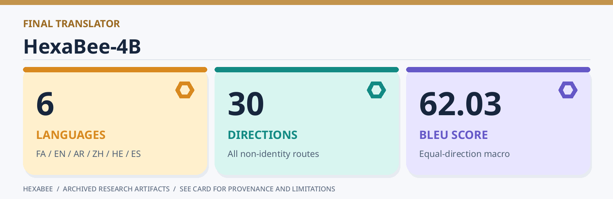
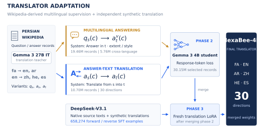

# HexaBee-4B research code

Code and configuration for the six-language HexaBee translation experiment. The repository follows the actual work: prepare Wikipedia text and multilingual answering data, build aligned translation supervision, render LoRA training configurations, evaluate matched predictions, and verify the reported numeric results.

**Paper:** Iman Barati, Mohammadmostafa Rostamkhani, and Mohammad Badzohreh, [*HexaBee-4B: Six-Language Translation with Multilingual Answering and Bidirectional Supervision*](https://arxiv.org/abs/2610.16361), arXiv:2610.16361 (2026). [Citation metadata](CITATION.cff).

**Languages:** Persian, English, Arabic, Chinese, Hebrew, and Spanish. **Task:** translation in all 30 non-identity directions. The released [final model](https://huggingface.co/Iman998/HexaBee-4B), [multilingual SFT data](https://huggingface.co/datasets/Iman998/HexaBee-Multilingual-SFT), and [evaluation archive](https://huggingface.co/datasets/Iman998/HexaBee-Evaluation) are separate from this code repository.



## Run the offline example

The example uses tiny hand-written records and artificial predictions. It checks the complete **CPU preparation and evaluation path**, and writes the five trainer/export YAMLs without launching GPU training or contacting an API.

```bash
python3 -m venv .venv
.venv/bin/python -m pip install -e '.[metrics,plots,dev]'
.venv/bin/python scripts/run_workflow.py --config configs/workflow.demo.json --stage all
```

On the ZharfaTech Maxwell cluster, run computation as a Slurm job after setting up the environment:

```bash
mkdir -p logs
sbatch jobs/workflow.sbatch configs/workflow.demo.json all
```

The output is under `runs/demo/`: prepared SFT files, registered pretraining text, training and merge configurations, evaluation metrics, paired bootstrap intervals, and an independent check of released numeric results. The example scores are **not** the paper's scores.

## Run your experiment

Copy [configs/workflow.example.json](configs/workflow.example.json) into `runs/experiment.json`, edit its input paths, and submit:

```bash
sbatch jobs/workflow.sbatch runs/experiment.json prepare
```

Paths in the JSON are absolute or relative to the repository root. The workflow links large pretraining source files into its ignored run directory, avoiding a second copy. It uses one canonical output directory for every phase. A full run requires your Wikipedia question/answer export, raw text sources, aligned pairs, and prompt pools. If you already have the original phase-2 or final translation SFT exports, set `phase2_sft` or `translation_sft` in the configuration to use those directly.

| Phase | Entry point | Output |
|:--|:--|:--|
| 1. Wikipedia text | `render_training.py --stage pretrain` | Registered raw text and a **new-experiment** PT LoRA YAML |
| 2. Multilingual answering and answer translation | `normalize-wiki`, `qa-build`, `export-sft` | Phase-2 SFT and continued-adapter YAML |
| 3. Aligned translation | `split`, `mt-build`, `export-sft` | Leak-aware split, forward/reverse SFT, fresh-adapter YAML |
| 4. Model adaptation | `jobs/train.sbatch` | PT adapter → multilingual adapter → merged base → translation adapter → final model |
| 5. Predictions and judging | `translate --prediction`, `judge` | Matched candidate and judge records |
| 6. Evaluation | `run_workflow.py --stage evaluate` | BLEU, chrF, chrF++, TER, reports, paired judge intervals |
| 7. Result check | `run_workflow.py --stage verify` | Rebuilt tables and checks from committed **numeric** evidence |

The preparation command renders all training YAMLs. Launch their GPU stages in order from [the Slurm guide](docs/workflow.md); it does not start a trainer automatically. Synthetic text and teacher translations can be produced with the explicit, cached commands in [generation.md](docs/generation.md). The evaluation stage consumes aligned prediction files supplied in the workflow config. New raw predictions and a model judge require the model or service named in that guide.

## Method and released artifacts



For a question in language $s$, multilingual answering teaches the model to answer in requested language $t$ and response style $v$. It does **not** translate the question. Direct translation instead uses aligned source and target texts. The adaptation sequence is Wikipedia continued pretraining → multilingual answering and answer-text translation → merge → fresh translation LoRA → final merge.

| Stage | Released data | Checkpoint |
|:--|:--|:--|
| Wikipedia text | [Wikipedia Foundations](https://huggingface.co/datasets/Iman998/HexaBee-Wikipedia-PT) | [PT LoRA](https://huggingface.co/Iman998/HexaBee-4B-PT-LoRA) |
| Multilingual answering | [Answering and translation SFT](https://huggingface.co/datasets/Iman998/HexaBee-Multilingual-SFT) | [SFT LoRA](https://huggingface.co/Iman998/HexaBee-4B-Multilingual-SFT-LoRA) · [merged base](https://huggingface.co/Iman998/HexaBee-4B-Multilingual-Base) |
| Bidirectional translation | [Aligned pairs and final SFT](https://huggingface.co/datasets/Iman998/HexaBee-Bidirectional-Translation) | [Translation LoRA](https://huggingface.co/Iman998/HexaBee-4B-Translation-LoRA) · [final model](https://huggingface.co/Iman998/HexaBee-4B) |
| Audit | [Prompt pools](https://huggingface.co/datasets/Iman998/HexaBee-System-Prompts) · [model outputs](https://huggingface.co/datasets/Iman998/HexaBee-Model-Outputs) | [Evaluation archive](https://huggingface.co/datasets/Iman998/HexaBee-Evaluation) |

The recorded phase-2 mixture contains **19,458,332 answering** and **10,695,072 answer-text translation** records. Final translation SFT has **658,274** forward/reverse records. The numeric evidence under `results/paper/` reports the following equal-direction macros over 36,572 synthetic test examples per system:

| System | BLEU ↑ | chrF ↑ | chrF++ ↑ | TER ↓ | COMET ×100 ↑ |
|:--|--:|--:|--:|--:|--:|
| Gemma 3 4B IT | 40.70 | 58.91 | 57.11 | 51.40 | 85.88 |
| Gemma 3 12B IT | 50.54 | 68.70 | 66.83 | 38.89 | 88.20 |
| **HexaBee-4B** | **62.03** | **75.08** | **73.75** | **30.05** | **89.86** |

These are archived research results with synthetic references, differing recorded inference prompts, and model-based judging. They are not an official shared-task ranking. The experiment evaluates the complete adaptation sequence; it does not isolate the causal contribution of answering. See [evaluation.md](docs/evaluation.md) and [reproducibility.md](docs/reproducibility.md).

A checkpoint comparison of phase 1, phases 1+2, and translation-only v2 is described in [ablation.md](docs/ablation.md). Its raw outputs and non-judge metric results are kept with the paper workspace, separate from the archived results above.

## Repository map

```text
configs/         Research recipes, training templates, workflow examples
assets/          Visual identity used by the README and Hub cards
examples/        Tiny offline fixtures; not research data
figures/         Regenerable method and result illustrations
jobs/            Slurm CPU and typed-GPU job entry points
scripts/         Workflow, trainer/merge rendering, numeric verification
src/pct4b/       Streaming data, prompts, generation, evaluation, Hub tools
results/paper/   Numeric evidence and provenance for published tables
tests/           Offline regression and integration checks
docs/            Input formats, stages, evaluation, release instructions
```

The Python namespace `pct4b` and `pct4b` command retain the historical experiment label. `hexabee` is an equivalent CLI. The images and explanations support the documentation and Hub cards. Source data, checkpoints, raw model outputs, API caches, and the manuscript are separate from this Git repository.

## Verification and scope

```bash
ruff check src scripts tests
ruff format --check src scripts tests
pytest -q
python scripts/reproduce_paper.py
```

The saved numeric artifacts verify aggregate scores and paired intervals. They cannot replace the original source, reference, and candidate strings for a fresh full metric pass. The historical phase-1 trainer YAML, exact teacher revisions, and original unseeded split membership were not archived. This repository supplies a runnable **new** PT recipe and preserves the recorded stage-2/3 settings; it does not promise bit-identical checkpoint reconstruction. See [reproducibility.md](docs/reproducibility.md).

Full instructions: [workflow and Slurm](docs/workflow.md) · [data formats](docs/data.md) · [training](docs/training.md) · [evaluation](docs/evaluation.md) · [checkpoint ablation](docs/ablation.md) · [Hugging Face release](docs/huggingface.md).

Software license: [MIT](LICENSE). Dataset and model terms are described in [DATA_AND_MODELS.md](DATA_AND_MODELS.md). Please cite the [arXiv paper](https://arxiv.org/abs/2610.16361) using [CITATION.cff](CITATION.cff).
